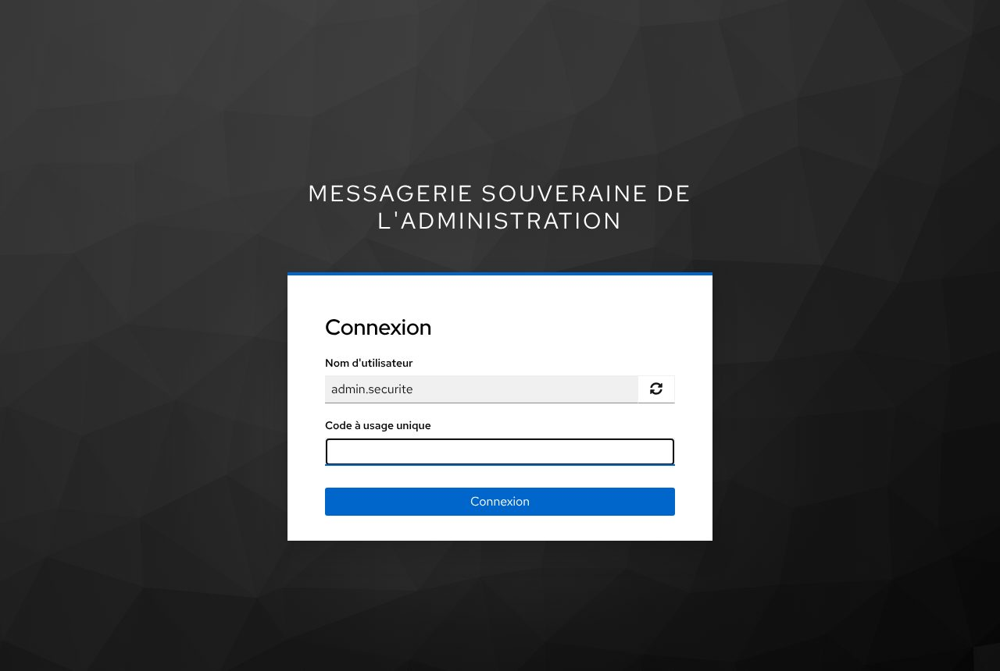
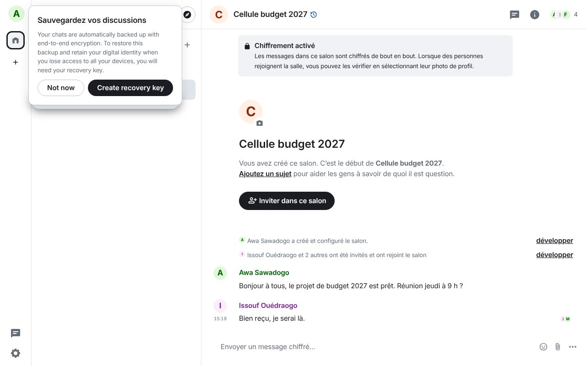
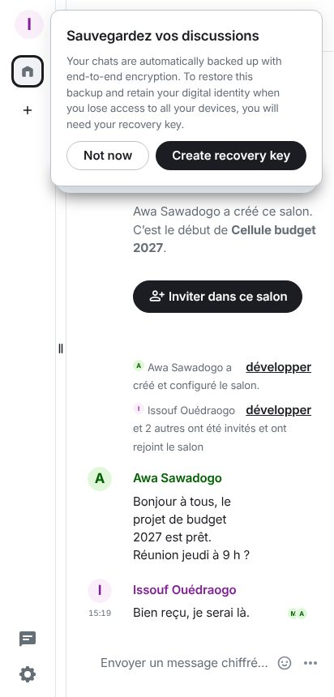
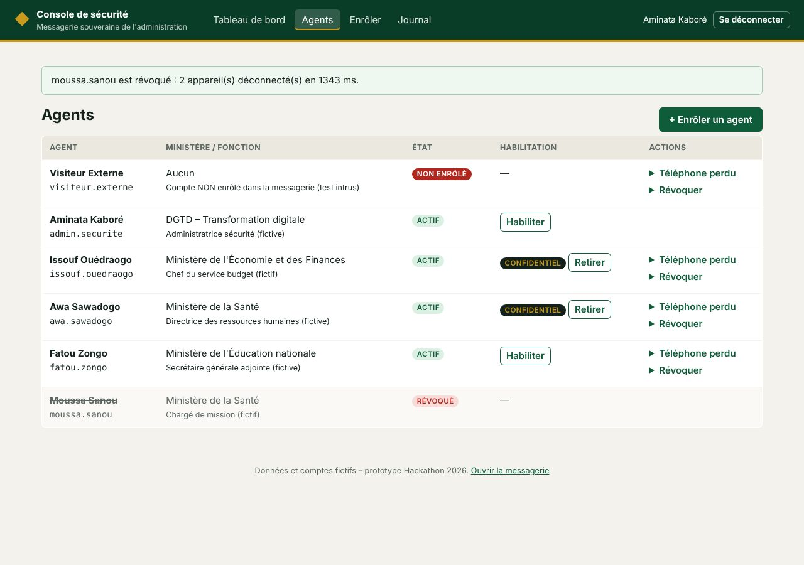
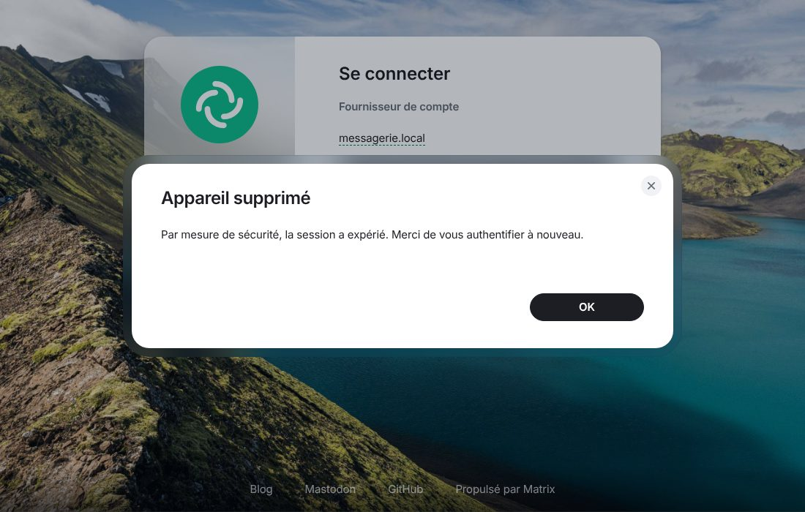
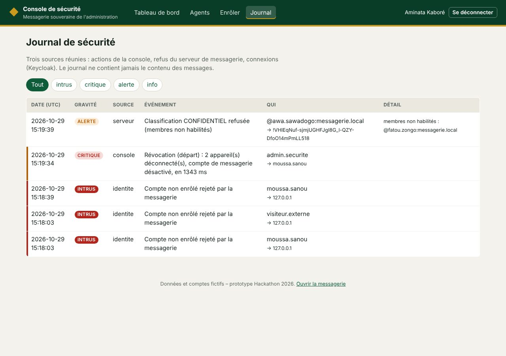

# Comptes de démonstration et scénario du jury

Tous ces comptes sont **fictifs** et n'existent que dans ce prototype. Les secrets ci-dessous
sont publics : ils ne doivent **jamais** servir dans un vrai déploiement (`./installer.sh
--reinitialiser` repart de zéro ; un vrai déploiement n'importe pas ces comptes).

## Comptes

| Identifiant | Mot de passe | Rôle dans la démo | Clé TOTP (Base32) |
|---|---|---|---|
| `admin.securite` | `Demo-Admin-2026` | Aminata Kaboré, administratrice sécurité : accès à la console | `IRSW232BMRWWS3STMVRXKMRQGI3CCII` |
| `awa.sawadogo` | `Demo-Awa-2026` | Agente habilitée CONFIDENTIEL | `IRSW232BO5QVGYLXMFSG6Z3PGIYDENQ` |
| `issouf.ouedraogo` | `Demo-Issouf-2026` | Agent habilité CONFIDENTIEL | `IRSW232JONZW65LGJ52WKZDSMFXTENQ` |
| `fatou.zongo` | `Demo-Fatou-2026` | Agente **non** habilitée | `IRSW232GMF2G65K2N5XGO3ZSGAZDMII` |
| `moussa.sanou` | `Demo-Moussa-2026` | Agent qui « quitte l'administration » (révocation) | `IRSW232NN52XG43BKNQW433VGIYDENQ` |
| `visiteur.externe` | `Demo-Visiteur-2026` | Identité valide mais **non enrôlée** : l'intrus | `IRSW232WNFZWS5DFOVZEK6DUGIYDENQ` |

**Obtenir le code à 6 chiffres** : scanner le QR code du compte (`docs/qr-totp/<compte>.png`)
avec une application TOTP (FreeOTP, Aegis, Google Authenticator…), ou lancer
`python3 outils/code_totp.py awa.sawadogo`. Un même code ne peut servir qu'**une fois**.

## Préparer la démonstration (10 minutes, la veille)

1. `./installer.sh 192.168.x.x` (adresse IP du PC sur le Wi-Fi) ; installer `ca-messagerie.crt`
   sur le PC et sur le téléphone de démonstration.
2. Ouvrir trois fenêtres : **Awa** (navigateur), **Issouf** (téléphone avec Element, serveur
   `https://192.168.x.x:8443`), **Moussa** (fenêtre de navigation privée).
3. Créer avec Awa un salon « Cellule budget 2027 », inviter Issouf, Fatou et Moussa.
4. Ouvrir la console de sécurité (`/console`, compte `admin.securite`).

## Scénario de la vidéo (3 minutes)

| Temps | Ce qu'on montre | Ce qu'on dit |
|---|---|---|
| 0:00 | Connexion d'Awa : mot de passe puis code TOTP | « Seuls les agents enrôlés entrent, toujours avec un second facteur. » |
| 0:20 | `visiteur.externe` se connecte avec un bon mot de passe et un bon code : **refusé**. La console affiche « INTRUS ». | « Avoir un compte ne suffit pas : il faut avoir été enrôlé. » |
| 0:40 | Awa écrit dans « Cellule budget 2027 » ; Issouf lit sur son téléphone. | « Web et mobile, même conversation, chiffrée de bout en bout. » |
| 1:00 | `./outils/ce-que-voit-le-serveur.sh` puis `./outils/ce-que-voit-le-serveur.sh "budget"` → **0** | « Voici ce que stocke le serveur : du texte chiffré. Le mot n'y figure nulle part. » |
| 1:30 | Console → Moussa → **Révoquer**. Sa fenêtre est déconnectée aussitôt ; il disparaît du salon ; il ne peut plus se reconnecter. | « Un agent quitte l'administration : un clic, tous ses appareils sont coupés. » |
| 2:00 | Awa renomme un salon en `[CONFIDENTIEL] …` alors que Fatou y est : **refusé**. Avec Issouf seul : accepté, messages effacés après 7 jours. | « La classification est imposée par le serveur, pas par la bonne volonté. » |
| 2:30 | `cd tests && python -m pytest -q` : 41 tests verts. Journal de la console. | « Chaque garantie est vérifiée automatiquement. Tout est open source. » |

## Lancer les tests sur l'installation Docker

```bash
pip install -r tests/requirements.txt
cd tests && python -m pytest -v
```

Les tests créent des agents « Test … » dans l'annuaire. Pour une démonstration propre,
lancez-les **avant** `./installer.sh --reinitialiser`, ou après la vidéo.

## Captures (répétition du scénario sur une installation neuve)

| | |
|---|---|
|  Connexion : code TOTP exigé |  Awa (navigateur) : salon chiffré |
|  Issouf (téléphone) : même conversation |  Console : Moussa révoqué, 2 appareils coupés |
|  Fenêtre de Moussa : déconnectée aussitôt |  Journal : intrus, révocation, classification refusée |
